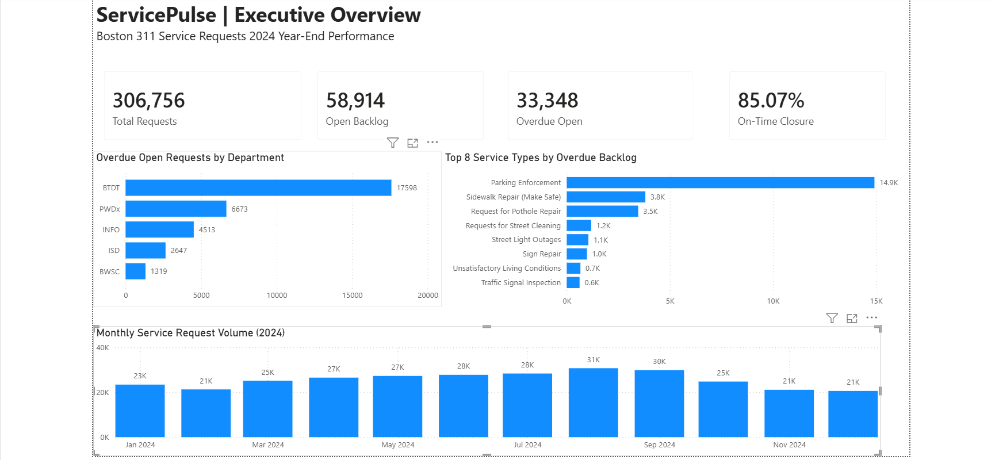

# ServicePulse | Operational Performance & Process Improvement

**Python · SQLite · SQL · Power BI | 306,756 Boston 311 service requests**

ServicePulse is an end-to-end operational analytics portfolio project that reconstructs the year-end 2024 service backlog, identifies concentrated delays, and translates the findings into practical investigation priorities.

**Historical snapshot:** December 31, 2024, 23:59:59.

[Open the Power BI report](Dashboards/Operations-Dashboard.pbix) · [Detailed analytical findings](docs/milestone_2_findings.md) · [Metric definitions](docs/metric_definitions.md)

## Executive findings

| Metric | Result |
|---|---:|
| Requests imported | 306,756 |
| Closed by snapshot | 247,842 |
| Open at snapshot | 58,914 |
| Overdue open requests | 33,348 |
| On-time share of evaluable closed cases (source flags) | 85.07% |

BTDT accounts for 52.8% of the historical overdue backlog. Its Parking Enforcement service accounts for 14,854 overdue open requests, or 44.5% of the citywide overdue backlog.

## Power BI report

### 1. Executive Overview

The executive page provides the operational baseline and supports prioritization of departments and service categories for further investigation.



### 2. Bottleneck Analysis

The focused Parking Enforcement page examines backlog age, queue concentration and recorded target windows.


| Parking Enforcement diagnostic | Result |
|---|---:|
| Open requests | 14,988 |
| Overdue open requests | 14,854 |
| Open backlog aged at least 30 days | 83.5% |
| Overdue open requests in primary queue | 99.7% |
| Requests with recorded target windows of 1–7 days | 99.2% |

**Management recommendation:** Review case-closure procedures, target-setting policies and queue monitoring before recommending staffing or workflow changes. The observed concentration identifies an investigation priority, not a proven root cause.

## Technical approach

Official CSV → Python validation and privacy-minimized ingestion → SQLite and SQL reporting views → diagnostic aggregates → Power BI.

The project demonstrates historical snapshot reconstruction, data validation, denominator-aware KPI design, SQL aggregation, operational diagnostics and evidence-based communication.

This is an independent portfolio analysis, not a City of Boston project or an implemented process intervention. The raw CSV is not committed because street-level locations and free-text fields are unnecessary for the analysis.

## Data source

Publisher: **City of Boston / Analyze Boston**. Dataset: [311 Service Requests](https://data.boston.gov/dataset/311-service-requests); annual CSV: [311 Service Requests - 2024](https://data.boston.gov/dataset/8048697b-ad64-4bfc-b090-ee00169f2323/resource/dff4d804-5031-443a-8409-8344efd0e5c8/download/lagan_311_open_data_2024_rvsd3.csv).

The downloadable annual file has the case identifier, opening/closing and
target dates, source on-time label, type, department, queue, neighborhood and
intake source. The source can be updated after 2024 and its published on-time
labels are not equivalent to independently measured staffing productivity.

## Quick start (Windows PowerShell, macOS or Linux)

Requires Python 3.10+; no third-party runtime packages.

```bash
python -m pip install -e .
python -m unittest discover -s tests -v
python scripts/download_data.py
python -m servicepulse --input data/raw/boston_311_2024.csv --as-of 2024-12-31T23:59:59
```

If automated download is blocked, use the City of Boston link above and
manually save the file to `data/raw/boston_311_2024.csv`.

This will create:

- `build/servicepulse.sqlite`: trimmed analytical case table and SQL views.
- `build/reporting/v_department_summary.csv`: department KPIs and reporting denominators.
- `build/reporting/v_type_summary.csv`: service-type workload, backlog and timeliness.
- `build/reporting/v_monthly_summary.csv`: monthly opened cohorts and snapshot outcomes.
- `build/reporting/v_open_backlog.csv`: individual open cases and age at snapshot (public case IDs only).
- `build/reporting/reporting_manifest.json`: source SHA-256, exclusions, reconciliation and metric caveats.

**Reproduction note:** the published findings refer to the documented source extract. A later source revision may yield different results. The
tests use a tiny fictional fixture, not an assertion about 2024 real data.

## Reproduce the bottleneck investigation

After generating the reporting tables, run:

```bash
python scripts/analyze_bottlenecks.py
python scripts/diagnose_service.py
python scripts/audit_service_targets.py
```

Diagnostic aggregates are generated in `build/analysis`. Open the committed PBIX in Power BI Desktop; if refreshing locally, update source paths to your generated reporting and diagnostic files as needed. The raw CSV, SQLite database and case-level exports should remain local.

## Main analytical decisions

- Use one complete year of the **legacy** backend, because 2025/2026 spans a system transition.
- For 2024 requests, reconstruct the year-end snapshot using actual close dates; later closure must not erase the historical backlog.
- Count published `ONTIME` / `OVERDUE` status only for cases closed by snapshot with a usable status flag; report denominator.
- Exclude invalid and negative cycle durations from time averages; separate anomalous timelines from both closed and open backlogs, and report validation counts.
- Do not infer rework, staffing, team handoffs, active handling time or proven causes: these are not captured by the data.
- Compare like-for-like service types before suggesting bottlenecks or interventions.

For definitions, assumptions and cautions see [metric definitions](docs/metric_definitions.md).

For initial results from the real 2024 extract, see [Milestone 2 operational findings](docs/milestone_2_findings.md). These identify BTDT Parking Enforcement as a concentrated historical backlog case, while avoiding unsupported causal claims.

## Repository structure

```text
servicepulse-operations/
├── data/raw/                 # Not committed: full public exports
├── src/servicepulse/        # Validation, SQLite ingestion, reporting CLI
├── sql/reporting_views.sql  # Four reporting views + snapshot case view
├── scripts/download_data.py # Optional official CSV downloader
├── tests/                   # Regression tests using a small fictional fixture
├── Dashboards/              # Power BI report and screenshots
├── docs/                     # Metric definitions and detailed findings
└── .github/workflows/ci.yml
```

**Status:** Portfolio release complete: data pipeline, documented operational analysis and two-page Power BI report. Future extensions could include monthly cohort diagnostics and explicitly hypothetical improvement scenarios; no realized savings or causal effects are claimed.
