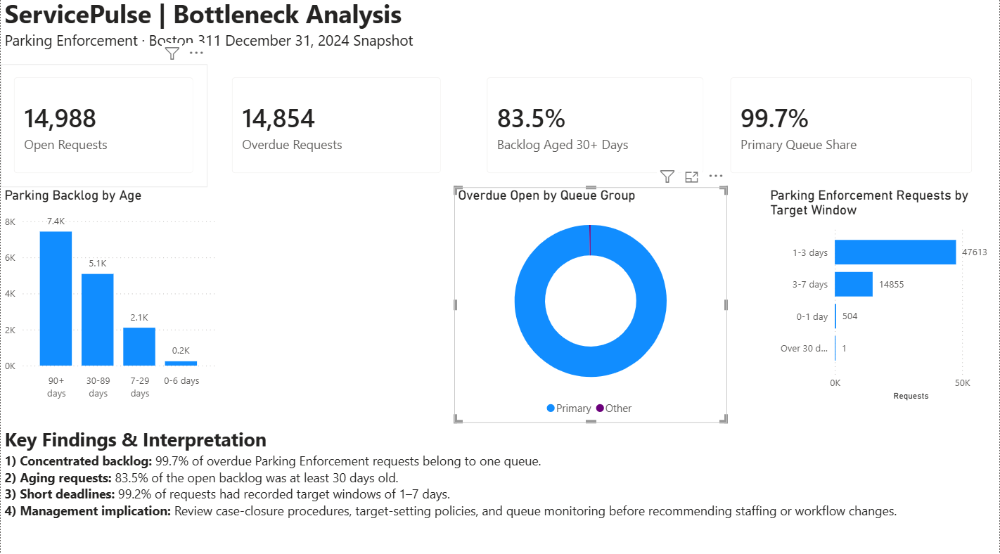

# ServicePulse | Operational Performance & Process Improvement

Service managers need to know where delays accumulate and which queues warrant investigation. I built a reporting pipeline and Power BI report using 306,756 public Boston 311 service requests opened in 2024.

## Findings

| Metric | Result |
|---|---:|
| Requests imported | 306,756 |
| Closed by snapshot | 247,842 |
| Open at snapshot | 58,914 |
| Overdue open requests | 33,348 |

Parking Enforcement accounted for 14,854 overdue open requests (44.5% of the citywide total). Of its open requests, 83.5% were at least 30 days old. One queue accounted for 99.7% of its overdue requests.

**Recommendation:** Review case closure, recorded service targets and queue monitoring before changing staffing or workflows.

## Power BI report

[Download Power BI report](Dashboards/Operations-Dashboard.pbix) | [Detailed findings](docs/milestone_2_findings.md) | [Metric definitions](docs/metric_definitions.md)

## Approach

I validated source records in Python, minimized the retained personal data, reconstructed the historical backlog in SQLite, and created SQL reporting views and Power BI measures. Automated tests cover the pipeline.

The [City of Boston dataset](https://data.boston.gov/dataset/311-service-requests) was analyzed as of December 31, 2024, 23:59:59. This is an independent historical analysis, not a current backlog report or proof of the causes of delays.

## Reproduce

From the repository root, install with `python -m pip install -e .`, run `python scripts/download_data.py`, then `python -m servicepulse --input data/raw/boston_311_2024.csv --as-of 2024-12-31T23:59:59`. Diagnostic scripts are in `scripts/`; run tests with `python -m unittest discover -s tests -v`.
